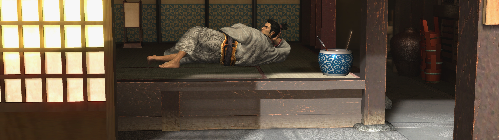
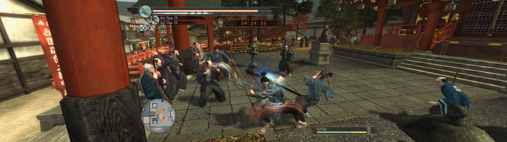
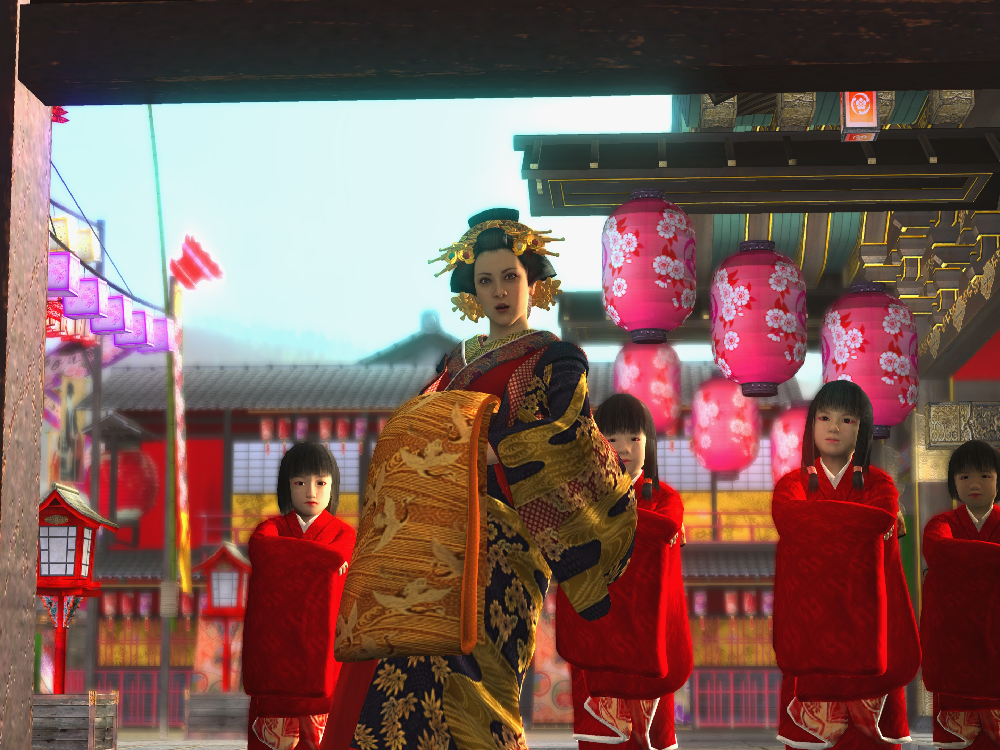
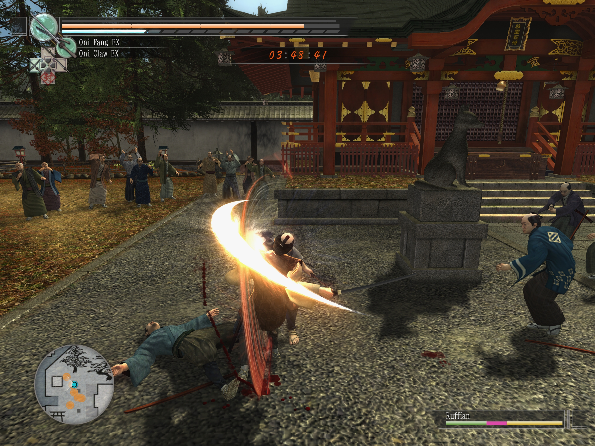

# KenzanPatches


**Patches for *Ryu ga Gotoku Kenzan!* on RPCS3: the whole game at 60 FPS or 120 FPS at its original speed, full ultrawide support (now also 16:10, 3:2 and 4:3), saving anywhere from the pause menu (Experimental), easier substory tracking with map markers for every collectible and side activity, and a wide variety of patches for visuals and game functionality, with optional cheats.**





*The game at 3840x1080 with `Aspect ratio` at 32:9, `120 FPS`, `Clean picture` and the shadow and stage detail entries.*

KenzanPatches is one RPCS3 patch file, `imported_patch.yml`. Each change is an entry that you tick in RPCS3's Game Patches window. No game file is changed, and the optional entries do nothing until you tick them.

[](https://cptpakundo.github.io/KenzanPatches/compare/)

**[Drag the slider to see it for yourself](https://cptpakundo.github.io/KenzanPatches/compare/)**. Left: the original picture. Right: the `Clean picture` entry.

**[Download 3.1](https://github.com/CptPakundo/KenzanPatches/releases/latest)** · [Install](#install) · [120 FPS setup](#120-fps-setup) · [Aspect ratio setup](#aspect-ratio-setup) · [Map markers](#map-markers) · [Supported versions](#supported-versions) · [Coming from 3.0](#coming-from-30) · [Coming from 2.2](#coming-from-22-or-older) · [All entries](#all-entries) · [Troubleshooting](#troubleshooting)

> [!IMPORTANT]
> **The entries are now grouped by type: tick your entries again.** The 3.1 file was updated on 2026-11-15. Every entry except the frame-rate entries has a new group in front of its name, so entries of one type sit together in Game Patches (`Gameplay - Controls`, `Map markers - Places`, `Visuals - Picture`, ...). RPCS3 keeps a tick under the entry name, so the old ticks no longer count. The frame-rate entries keep their names and their ticks. Nothing else changed.
>
> **Coming from 3.0?** Tick your entries again too. The map marker entries replace Side mission markers and More map markers, and Ultrawide is now `Aspect ratio`. See [Coming from 3.0](#coming-from-30).
>
> **Coming from 2.2 or older? Tick your entries again, once.** 3.0 lists the game once per version and renames every entry, so RPCS3 no longer finds your old ticks. Also untick the old entries under the plain title `Ryu ga Gotoku Kenzan!`. See [Coming from 2.2 or older](#coming-from-22-or-older).

## What is in it

1. **60 FPS and 120 FPS.** The whole game at the game's original speed: fights, Heat Actions, cutscenes, the open world and all 14 minigames. If your PC falls behind, the game draws fewer frames and keeps its pace.
2. **Full ultrawide support, and more aspect ratios.** `Aspect ratio` gives 21:9 and 32:9 screens a wider 3D view and 16:10, 3:2 and 4:3 screens (Steam Deck, many laptops and tablets, older monitors) a taller one, with the HUD, menus and text at their true shape, movies with black bars, and fades and backdrops across the whole screen. Two spots stay stretched (see [Aspect ratio setup](#aspect-ratio-setup)).
3. **Save anywhere (Experimental).** `Save from the pause menu` puts Save on Triangle in the pause menu, in free roam. It is greyed out where a save is not safe (see [Save from the pause menu](#save-from-the-pause-menu)).
4. **Easier substory tracking, now with map markers for everything.** Markers on the minimap and the pause map for every collectible and side activity: a green "?" where a Request or Contract can start now and a blue "?" where its next step is ready, each Wanted Man's poster face, Revelation sketches, locker keys, turtles, items, the minigames, shops and more, with a NEW badge where there is something new. In the pause map's List (Triangle) each marker gets its own named row, and picking a row points at it. Tick `Core (required)` under `Map markers - Base` and the kinds you want (see [Map markers](#map-markers)). `Notebook tracker` makes the Notebook list every substory (Requests, Contracts, Wanted Men) as Locked with what to do first, Not now, or Available with where to go. Each of these entries works on its own: tick only `Core (required)` and `Requests` for the map marks without any hints in the Notebook.
5. **A wide variety of patches for visuals and game functionality, with optional cheats.** `Clean picture` (the slider above), Photo mode, a hidden HUD, field of view, camera, shadows, bloom, depth of field, text speed, shorter fades, controls and comfort; cheats and fifteen minigame assists, all off until you tick them; and one fix for a freeze of the original game.

In all: 114 entries for each English title (2 frame-rate entries, 14 minigame entries, `Clean picture`, 96 optional entries and the bug fix). The Japanese original has 113: `Notebook tracker` is for the English builds only.

## Supported versions

| Game version | Executable hash | Title to open in Game Patches |
|---|---|---|
| [English fan translation](https://www.moddb.com/mods/ry-ga-gotoku-kenzan-english-translation-patch), **patch 13**: the current version and the default (RPCS3 EBOOT) | `PPU-8ebf5df2793c2a38c8ac4a2538d003c326d554a1` | `Ryu ga Gotoku Kenzan! (English translation)` |
| English fan translation, **patches 6 to 12** (RPCS3 EBOOT) | `PPU-0f7ee1f50561dd854f48d4a74fbcb7b30f0307d6` | `Ryu ga Gotoku Kenzan! (English translation, patches 6 to 12)` |
| English fan translation, **initial release** (its first release, RPCS3 EBOOT) | `PPU-5d3cde094c0be606290c4716da497bced59c1256` | `Ryu ga Gotoku Kenzan! (English translation, initial release)` |
| Japanese original | `PPU-fc24101547eff0f4307d4f70a0cb76329f11a525` | `Ryu ga Gotoku Kenzan! (Japanese original)` |

- Each title belongs to one executable hash. Tick entries only under the title of your version: entries under another title do nothing for your game.
- **Moving to patch 13?** RPCS3 keeps each tick under the executable hash, the entry name and the title, and patch 13 has a new hash. Tick your entries again, once, under `Ryu ga Gotoku Kenzan! (English translation)`.

> [!NOTE]
> **English translation users:** make sure you followed the translation's *Extra Steps (RPCS3 Only)*: rename `EBOOT.BIN` to `EBOOT PS3.BIN`, then rename `EBOOT RPCS3.BIN` to `EBOOT.BIN`.

Not sure which one you have? Boot the game once, close RPCS3, and search `log\RPCS3.log` for `PPU executable hash`.

<details>
<summary><b>More on versions</b></summary>

- Patch 13 has a new EBOOT with its own executable hash, so it has its own title. Its entries are the same as for patches 6 to 12, line for line. Patches 6 to 12 share one EBOOT.
- The `Framerate - Minigames` entries and the minigame assists are listed under all three English titles: the translation did not change the minigame files from the initial release to patch 13. If you move from patches 6 to 12 to patch 13, their old ticks still count (same files, and the entry still lists the title you ticked it under). You can also tick them again under `Ryu ga Gotoku Kenzan! (English translation)`: RPCS3 applies an entry when it is ticked under any of its titles.
- Other English mods and other builds of the translation have a different hash, so these entries will not apply to them. The translation's PS3 EBOOT (`PPU-16d1a050...`) is not supported either: use its RPCS3 EBOOT.
- Use the log file rather than RPCS3's log window, which can hide the `PPU executable hash` line. [Troubleshooting](#troubleshooting) also shows how to tell the version from RPCS3's cache folder.

</details>

## Install

1. Download [`imported_patch.yml`](https://github.com/CptPakundo/KenzanPatches/releases/latest/download/imported_patch.yml)
   from the [latest release](https://github.com/CptPakundo/KenzanPatches/releases/latest).
2. Place it in RPCS3's `patches` folder, keeping the name `imported_patch.yml`:

   | OS | Folder |
   |---|---|
   | Windows | `<RPCS3 folder>\patches\` |
   | Linux | `~/.config/rpcs3/patches/` |
   | macOS | `~/Library/Application Support/rpcs3/patches/` |

   Already have an `imported_patch.yml`? Merge the two files instead of replacing yours (see below).
3. In RPCS3, open **Manage → Game Patches**. The game is listed four times, once per version. Open the title for **your** version (see [Supported versions](#supported-versions)) and ignore the others. Under your title, tick:

   | Group | Tick |
   |---|---|
   | `Framerate - Core` | **One** of `60 FPS` or `120 FPS` |
   | `Framerate - Minigames` | **All** of them |
   | `Gameplay - Bug fix` | `Turtle title race freeze` (it does nothing until the freeze case comes up) |
   | `Visuals - Picture` | `Clean picture`; `Aspect ratio` if your screen is not 16:9 |
   | `Map markers - Base` | `Core (required)`, with the marker entries you want under `Map markers - Collectibles`, `Map markers - Missions` and `Map markers - Places` |
   | `Gameplay - Controls`, `Gameplay - Convenience`, `Sound` and the other `Visuals` groups | Any extras you want |
   | The `Gameplay cheats` groups | Nothing, unless you want them |

4. Click **Save**. **Chose 120 FPS?** Do the short [120 FPS setup](#120-fps-setup). **Is your screen not 16:9?** Do the short [Aspect ratio setup](#aspect-ratio-setup). Otherwise you are done.
5. Start the game. The first boot takes longer while RPCS3 recompiles the patched code.

<details>
<summary><b>Merging with an existing <code>imported_patch.yml</code></b></summary>

1. Keep a single `Version: 1.2` line at the very top of your file.
2. Copy everything below that line from this patch to the end of your file.
3. A file can only have one `Anchors:` section. If yours already has one, move this patch's indented anchor lines under
   your existing `Anchors:` line and delete the second `Anchors:` line.

</details>

<details>
<summary><b>What the list looks like in Game Patches</b></summary>

```
Ryu ga Gotoku Kenzan! (English translation)                    patch 13 (the default), 114 entries
└─ BLJM60064 01.00
   ├─ Framerate - Core: 120 FPS | 60 FPS                       pick one
   ├─ Framerate - Minigames: (14, tick all)
   │    Cee-lo, Cho-han, Iaigiri Spirit Tempering, Iroha Karuta, Jiraiya Training, Koi-koi,
   │    Konpira Fune Fune, Mahjong, Shogi, Tokkuri Toppling, Tosenkyo, Turtle Racing,
   │    Waterfall Meditation, Yabusame
   ├─ Gameplay - Bug fix: Turtle title race freeze
   ├─ Gameplay - Controls: (9)
   │    Camera distance, Camera speed, Camera vertical reach, Lock-on toggle, Run threshold,
   │    Smart lock-on, Sprint sooner, Stick dead zone, Vibration
   ├─ Gameplay - Convenience: (7)
   │    Idle monologue, Notebook tracker, Retry on Legend, Save from the pause menu,
   │    Short boot logos, Side missions at any hour, Skip hold
   ├─ Gameplay cheats - Combat: (15)
   │    Accessory effects, Damage dealt, Damage taken, Enemies attacking at once,
   │    Enemies never block, Enemy health, Forgiving prompts, Healing, Heat always full, Heat gain,
   │    Hold to mash, Never die, Street weapon durability, Untouchable, Weapon wear
   ├─ Gameplay cheats - Growth: (3)
   │    Experience multiplier, Experience penalty, Sprint from the start
   ├─ Gameplay cheats - Minigames: (16)
   │    Cee-lo, Cho-han, Iaigiri Spirit Tempering, Iroha Karuta, Jiraiya Training, Kabuki Acting,
   │    Koi-koi, Konpira Fune Fune, Mahjong, Scarecrow Formations, Shogi, Tokkuri Toppling,
   │    Tosenkyo, Turtle title races, Waterfall Meditation, Yabusame
   ├─ Gameplay cheats - Money and items: (8)
   │    Coliseum prize item, Coliseum prize money, Forging materials, Free spending,
   │    Items are not used up, Money multiplier, Shop prices, Talk fees
   ├─ Gameplay cheats - Street: (3)
   │    Drunkenness, Encounter rate, Encounter refresh
   ├─ Map markers - Base: Core (required)
   ├─ Map markers - Collectibles: (6)
   │    Items, Locker keys, Mission items, Oni's keys, Revelations, Turtles
   ├─ Map markers - Missions: (3)
   │    Contracts, Requests, Wanted Men
   ├─ Map markers - Places: (10)
   │    Antique salesman, Cee-lo, Hozoin tournament, Junk buyer, Koi-koi, Mahjong, Notice Board,
   │    Shogi, Turtle seller, Yujo dates
   ├─ Sound: Volume balance
   ├─ Visuals - Camera: Field of view
   ├─ Visuals - Interface: (4)
   │    Fade speed, Hide HUD, Photo mode, Text speed
   ├─ Visuals - Picture: (8)
   │    Aspect ratio, Bloom intensity, Clean picture, Depth of field, Shadow blur, Shadow map 2048,
   │    Shadow range, Stage detail
   └─ Visuals - World: (2)
        Time of day, Weather
Ryu ga Gotoku Kenzan! (English translation, patches 6 to 12)   the same 114 entries
Ryu ga Gotoku Kenzan! (English translation, initial release)   the same 114 entries
Ryu ga Gotoku Kenzan! (Japanese original)                      113: no Notebook tracker
```

Each entry's full name is its group, a colon and its name, for example `Visuals - Picture: Aspect ratio`. RPCS3 sorts the entries by full name, so the entries of one group sit together, the groups are sorted by name, and so are the entries inside each group. The minigame names are the English translation's own words, as in the game's Completion List.

</details>

### 120 FPS setup

One custom configuration for the game, with Vblank Rate 120.

<details>
<summary><b>Show the 120 FPS setup</b></summary>

1. Right-click the game → **Create Custom Configuration From Global Settings** (or **Change Custom Configuration** if the game already has one).
2. Set:

   | Setting | Value |
   |---|---|
   | Advanced → Vblank Rate | **120** (required, otherwise the game runs at half speed) |
   | GPU → Framerate Limiter | **Auto** (Off lets the game run far too fast) |
   | VSync | On only with a 120 Hz+ display, otherwise Off |

3. Click **Save**, then tick `120 FPS` (not `60 FPS`) under your version's title.
4. Is your screen not 16:9 either? Do the [Aspect ratio setup](#aspect-ratio-setup) as well: both settings go in the same custom configuration.

> **Important**
>
> Kenzan runs its logic once per frame. The patch keeps the game's speed by drawing fewer frames when your PC falls behind, down to about 30 FPS. That helps as long as your PC keeps up with the game logic itself. If it cannot, the game slows down, and in cutscenes the picture falls behind the sound.
>
> **On a weaker PC, use the 60 FPS entry.** It asks much less of your CPU. Very crowded places, such as the Gion festival at night, are the hardest, and there the limit is the emulated graphics work, so a lower Resolution Scale may not help.

Menus, dialogue and the start of Heat Actions run at 60 FPS, exactly as in the original game. The sections of six cutscenes that the original drops to 20 FPS run at the full frame rate of your entry. To switch back, set Vblank Rate to 60 and tick the 60 FPS entry instead.

</details>

### Aspect ratio setup

One setting in the game's custom configuration, and the `Aspect ratio` entry with the value that names your screen.





*The game at 2880x2160 with `Aspect ratio` at 4:3, `120 FPS`, `Clean picture` and the shadow and stage detail entries.*

<details>
<summary><b>Show the Aspect ratio setup</b></summary>

1. Right-click the game → **Create Custom Configuration From Global Settings** (or **Change Custom Configuration** if the game already has one, for example from the 120 FPS setup). On the **GPU** tab, turn on **Stretch To Display Area** and click **Save**. RPCS3's own tooltip: it overrides the aspect ratio and stretches the image to the full display area.
2. Tick `Aspect ratio` under `Visuals - Picture` and set its **Aspect ratio** value to the one that names your screen, then click **Save**:

   | Your screen | Aspect ratio |
   |---|---|
   | 2560x1080 or 5120x2160 | 21:9 (2560x1080, 5120x2160) |
   | 3440x1440 | 21:9 (3440x1440) (the default) |
   | 3840x1600 | 21:9 (3840x1600) |
   | 3840x1080, 5120x1440 or 7680x2160 | 32:9 (3840x1080, 5120x1440, 7680x2160) |
   | 1280x800 (Steam Deck), 1920x1200 or 2560x1600 | 16:10 (1280x800, 1920x1200, 2560x1600) |
   | 2160x1440, 2256x1504 or 3000x2000 | 3:2 (2160x1440, 2256x1504, 3000x2000) |
   | 1024x768, 1600x1200 or 2048x1536 | 4:3 (1024x768, 1600x1200, 2048x1536) |
   | 16:9 (1920x1080, 2560x1440, 3840x2160) | leave `Aspect ratio` unticked |

3. A value that does not name your screen gives the wrong shape: on a 16:9 screen a wide value squeezes the picture into the middle.
4. At 16:10, 3:2 and 4:3 the 3D view is taller, the HUD keeps its 16:9 distance from the top and bottom edges in play, menus are letterboxed and centred, and movies have bars at the top and bottom.
5. Two spots stay stretched: the quit dialog of the Ultimate Match and some menu backdrops at the sides.

</details>

### Map markers

Tick `Core (required)` under `Map markers - Base` and the marker entries you want. Each kind is its own entry, and every marker shows on the minimap and on the pause map.

<details>
<summary><b>Every kind of marker, its icon and its values</b></summary>

`Core (required)` draws the markers of all the marker entries: on its own it draws nothing, and a marker entry without it draws nothing. Its **Marker size** (Small / Medium / Large, default Medium) sets the size of every marker.

**Side missions** (`Map markers - Missions`). A green "?" marks where a Request or Contract can be started now; a Wanted Man on offer shows his own poster face at the Notice Board. **Mission progress** adds more:

- Next step (the default): a blue "?" where the next step of a mission you have begun can be done now. For a step inside a building, the "?" shows at its door and inside.
- Next step and blocked: also a red "?" where the next step is but cannot be done yet, for example at another time of day or later in the story.
- Off: only the green "?".

| Entry | What it marks | Values | Icon |
|---|---|---|---|
| `Requests` | Where a Request can be started now, and its next step. | Mission progress: Next step / Next step and blocked / Off. Default: Next step. | Green, blue and red "?" |
| `Contracts` | Where a Contract can be started now, and its next step. | Mission progress: Next step / Next step and blocked / Off. Default: Next step. | Green, blue and red "?" |
| `Wanted Men` | The man on offer at the Notice Board; once you have taken him on, his first place and the next step of his mission. Icon sets the mark at his first place. | Icon: Wanted poster / Pursuit / Item. Default: Wanted poster.<br>Mission progress: Next step / Next step and blocked / Off. Default: Next step. | The man's poster face on the parchment; blue and red "?" |

**Collectibles** (`Map markers - Collectibles`).

| Entry | What it marks | Values | Icon |
|---|---|---|---|
| `Revelations` | The places of the Revelations you can see now: you have the sketch and have not learned the technique. | Icon: Sketch / Item. Default: Sketch. | That Revelation's own sketch |
| `Locker keys` | The locker keys you have not picked up yet in the area you are in (keys J-3 to A-5), once the Request Storage Locker Instructions has explained the lockers. A key's marker goes once you pick it up. | Icon: Locker key / Locker. Default: Locker key. | The key's own picture |
| `Turtles` | The overturned turtles during their story scenes, the rescued turtles waiting in your room at the Tatsuya, the turtles in the fields and streets from chapter 5 on (only while one is there), and the Eternal Turtle in Gion when he appears. | No values. | Each turtle's own picture |
| `Items` | The items lying on the ground in the story (the temple in chapter 2, Ukiyo's house in chapter 3) until you pick them up. | No values. | Each item's own picture |
| `Oni's keys` | Each Oni's Key the Oni drop in chapter 12 until you pick it up. | No values. | The key's own picture |
| `Mission items` | The things a mission step asks you to find (Scrap of Paper, Rake, Bamboo Sticks, Red Book, the digging spot, Koetsu's Treasure), only while that step is on. | No values. | Each item's own picture |

**Places and people** (`Map markers - Places`).

| Entry | What it marks | Values | Icon |
|---|---|---|---|
| `Notice Board` | The notice board at the banya in Rakugai. With `Wanted Men` also ticked, the poster face of the man on offer takes the board's place. | No values. | The parchment; NEW while a new wanted poster is there |
| `Mahjong` | The mahjong players in Gion. | No values. | Mahjong point sticks |
| `Shogi` | The shogi challenge matches in Gion. | No values. | A shogi piece |
| `Koi-koi` | The koi-koi player in Rakugai. | No values. | Gambling tags; NEW when a new opponent has been added |
| `Cee-lo` | The cee-lo player in Rakugai. | No values. | Dice |
| `Turtle seller` | The man in Rakugai who sells turtles, turtle food and turtle buckets. | No values. | A turtle bucket; NEW while his free turtle bucket is on offer |
| `Junk buyer` | The man in Rakugai who buys your junk, from chapter 5 on. | No values. | A koban coin |
| `Antique salesman` | The traveling salesman of antiques at the Sanjusangendo, from chapter 10 on. | No values. | The picture of his next item; NEW while a new item is waiting |
| `Yujo dates` | The place where a yujo waits for her date with you. | No values. | A heart |
| `Hozoin tournament` | The tournament reception at the Hozoin, from chapter 9 on. | No values. | A ticket |

**The List.** On the pause map, Triangle opens the List. Each marker gets its own row there, with its name (the Request's title, the Wanted Man's name, the sketch, the turtle) and a category chip, beside the game's own places. Picking a row points the map's pointer at that marker.

`Hide HUD` set to Only the minimap hides the minimap with its markers; the pause map keeps them.

</details>

## Coming from 3.0

Replace `imported_patch.yml`, open Game Patches and **tick your entries again**, once, under your version's title. The entries are now grouped by type: every entry except the frame-rate entries has a new group in front of its name, for example Visuals and Functionality: Camera speed is now `Gameplay - Controls: Camera speed`. RPCS3 keeps each tick under the executable hash, the entry name and the title, so it no longer finds those ticks. The `Framerate - Core` and `Framerate - Minigames` entries keep their names and their ticks.

The same applies if you downloaded 3.1 before the update of 2026-11-15, when its entries were still under Visuals and Functionality, Gameplay cheats and Bug fix: replace the file and tick your entries again. Only the names changed.

From 3.0, the map markers and Ultrawide also changed. Side mission markers and More map markers are gone, and the marker entries replace them. Tick `Core (required)` under `Map markers - Base` and the kinds you want:

| You had (3.0) | Tick now (3.1), with `Core (required)` |
|---|---|
| Side mission markers | `Requests`, `Contracts` and `Wanted Men` (`Map markers - Missions`) |
| More map markers, Revelations | `Revelations` (`Map markers - Collectibles`) |
| More map markers, bounty targets | `Wanted Men` (its Icon value sets the mark) |
| The Marker size of either | **Marker size** of `Core (required)` |

Ultrawide is now `Aspect ratio` (`Visuals - Picture`), with new 16:10, 3:2 and 4:3 values: tick `Aspect ratio` again and set its value (see [Aspect ratio setup](#aspect-ratio-setup)).

<details>
<summary><b>Where each entry went</b></summary>

| Group before | Entries | Group now |
|---|---|---|
| Bug fix | Turtle title race freeze | `Gameplay - Bug fix` |
| Visuals and Functionality | Camera distance, Camera speed, Camera vertical reach, Lock-on toggle, Run threshold, Smart lock-on, Sprint sooner, Stick dead zone, Vibration | `Gameplay - Controls` |
| Visuals and Functionality | Idle monologue, Notebook tracker, Retry on Legend, Save from the pause menu, Short boot logos, Side missions at any hour, Skip hold | `Gameplay - Convenience` |
| Visuals and Functionality | Map markers (core), now `Core (required)` | `Map markers - Base` |
| Visuals and Functionality | Item, Locker key, Mission item, Oni's key, Revelation and Turtle markers, now `Items`, `Locker keys`, `Mission items`, `Oni's keys`, `Revelations` and `Turtles` | `Map markers - Collectibles` |
| Visuals and Functionality | Contract, Request and Wanted Men markers, now `Contracts`, `Requests` and `Wanted Men` | `Map markers - Missions` |
| Visuals and Functionality | The Antique salesman, Cee-lo, Hozoin tournament, Junk buyer, Koi-koi, Mahjong, Notice Board, Shogi, Turtle seller and Yujo date markers, now named by the place alone (`Yujo dates`) | `Map markers - Places` |
| Visuals and Functionality | Volume balance | `Sound` |
| Visuals and Functionality | Field of view | `Visuals - Camera` |
| Visuals and Functionality | Fade speed, Hide HUD, Photo mode, Text speed | `Visuals - Interface` |
| Visuals and Functionality | Aspect ratio, Bloom intensity, Clean picture, Depth of field, Shadow blur, Shadow map 2048, Shadow range, Stage detail | `Visuals - Picture` |
| Visuals and Functionality | Time of day, Weather | `Visuals - World` |
| Gameplay cheats | Accessory effects, Damage dealt, Damage taken, Enemies attacking at once, Enemies never block, Enemy health, Forgiving prompts, Healing, Heat always full, Heat gain, Hold to mash, Never die, Street weapon durability, Untouchable, Weapon wear | `Gameplay cheats - Combat` |
| Gameplay cheats | Experience multiplier, Experience penalty, Sprint from the start | `Gameplay cheats - Growth` |
| Gameplay cheats | The minigame assists, now named by the minigame alone (Assist - Mahjong is now `Mahjong`); Jiraiya Training pass lines, now `Jiraiya Training`; Turtle title races | `Gameplay cheats - Minigames` |
| Gameplay cheats | Coliseum prize item, Coliseum prize money, Forging materials, Free spending, Items are not used up, Money multiplier, Shop prices, Talk fees | `Gameplay cheats - Money and items` |
| Gameplay cheats | Drunkenness, Encounter rate, Encounter refresh | `Gameplay cheats - Street` |

</details>

## Coming from 2.2 or older

Replace `imported_patch.yml`, open Game Patches and **tick your entries again**, once, under your version's title. Then untick every entry under the plain title `Ryu ga Gotoku Kenzan!` of RPCS3's own patch list.

<details>
<summary><b>Why, and the table of old and new names</b></summary>

Up to 2.2 every entry sat under one title, with the game version at the end of its name. 3.0 has one title per game version and puts the group at the front of each name. RPCS3 keeps each tick under the executable hash, the entry name and the title, so the old ticks no longer match anything. The frame-rate entries and `Clean picture` do exactly what they did in 2.2.

> **Warning**
>
> **Untick the old entries.** RPCS3's own downloaded patch list still shows this game's entries under the old names, under the plain title `Ryu ga Gotoku Kenzan!`. Untick every entry under that plain title, then tick the new ones under your version's title.
> If you leave both ticked, the old and new 60 / 120 FPS entries share a group, so only one of them applies, but other entries ticked in both lists, such as Clean picture and the minigame entries, are applied twice.

The minigame entries now carry the English translation's own names for the minigames. Find your old entry in the left column:

| Old name (2.2) | New name, under your version's title |
|---|---|
| `60 FPS (English translation)`, `60 FPS (English translation, old version)`, `60 FPS (Japanese original)` | `Framerate - Core: 60 FPS` |
| `120 FPS (English translation)`, `120 FPS (English translation, old version)`, `120 FPS (Japanese original)` | `Framerate - Core: 120 FPS` |
| `Clean picture (English translation)`, `Clean picture (English translation, old version)`, `Clean picture (Japanese original)` | `Visuals - Picture: Clean picture` |
| `Minigame fixes - Bowling` | `Framerate - Minigames: Tokkuri Toppling` |
| `Minigame fixes - Chohan (English translation)`, `Minigame fixes - Chohan (Japanese original)` | `Framerate - Minigames: Cho-han` |
| `Minigame fixes - Hanafuda (English translation)`, `Minigame fixes - Hanafuda (Japanese original)` | `Framerate - Minigames: Koi-koi` |
| `Minigame fixes - K Yabusame` | `Framerate - Minigames: Jiraiya Training` |
| `Minigame fixes - Kamerace (English translation)`, `Minigame fixes - Kamerace (Japanese original)` | `Framerate - Minigames: Turtle Racing` |
| `Minigame fixes - Karuta (English translation)`, `Minigame fixes - Karuta (Japanese original)` | `Framerate - Minigames: Iroha Karuta` |
| `Minigame fixes - Konpira` | `Framerate - Minigames: Konpira Fune Fune` |
| `Minigame fixes - Mahjong (English translation)`, `Minigame fixes - Mahjong (Japanese original)` | `Framerate - Minigames: Mahjong` |
| `Minigame fixes - R Yabusame (English translation)`, `Minigame fixes - R Yabusame (Japanese original)` | `Framerate - Minigames: Yabusame` |
| `Minigame fixes - Shogi` | `Framerate - Minigames: Shogi` |
| `Minigame fixes - Suika (English translation)`, `Minigame fixes - Suika (Japanese original)` | `Framerate - Minigames: Iaigiri Spirit Tempering` |
| `Minigame fixes - Tintiro (English translation)`, `Minigame fixes - Tintiro (Japanese original)` | `Framerate - Minigames: Cee-lo` |
| `Minigame fixes - Tousenkyo (English translation)`, `Minigame fixes - Tousenkyo (Japanese original)` | `Framerate - Minigames: Tosenkyo` |
| `Minigame fixes - Waterfall (English translation)`, `Minigame fixes - Waterfall (Japanese original)` | `Framerate - Minigames: Waterfall Meditation` |

In 2.2 the translation's initial release used the `(English translation)` minigame entries. In 3.0 the minigame entries are listed under each English title (patch 13, patches 6 to 12 and the initial release share the same minigame files), and the Japanese original has its own.

> **Note**
>
> **Used the optional `sh_iori_ps3.par` from 1.7 or older?** You no longer need it: tick `Clean picture` instead. You can leave your copied file or restore your backup of the original: either is safe, and the picture is the same.

</details>

## All entries

Every entry, its values and its default. Each entry also carries notes in RPCS3.

- **Framerate - Core** (2): `60 FPS` or `120 FPS`, the frame-rate patch of 2.2.
- **Framerate - Minigames** (14): one entry per minigame that keeps it at the original speed. Tick all.
- **Gameplay - Bug fix** (1): a freeze of the original game in two Turtle Racing title races.
- **Gameplay - Controls** (9): camera distance, speed and reach, lock-on, running and sprinting, the stick dead zone, vibration.
- **Gameplay - Convenience** (7): `Save from the pause menu`, the Notebook tracker, Retry on Legend, side missions at any hour, the idle monologue, boot logos, skip hold.
- **Gameplay cheats - Combat** (15), **- Growth** (3), **- Minigames** (16), **- Money and items** (8), **- Street** (3): health, damage, Heat, experience, money, items, weapons, prices, street thugs, the Coliseum, and fifteen minigame assists. Cheats change the game's difficulty and economy, and what is written to your save: keep a copy of your save.
- **Map markers - Base** (1), **- Collectibles** (6), **- Missions** (3), **- Places** (10): `Core (required)` and its 19 marker entries.
- **Sound** (1): volume balance.
- **Visuals - Camera** (1), **- Interface** (4), **- Picture** (8), **- World** (2): field of view, Photo mode, the HUD, text speed, fades, `Clean picture`, `Aspect ratio`, shadows, bloom, depth of field, stage detail, weather and time of day.

<details>
<summary>How to set values</summary>

The optional entries do not need a frame-rate entry. Six entries are marked **Experimental.**, in the tables and in their notes in RPCS3.

**Values.** Many entries have values. Select the entry in Game Patches, set its values on the right, then click **Save**. `Bloom intensity` and `Depth of field` take a number in a box with arrows; the others offer a list.

Ticking an entry applies its default values. Where every default is the original game's value, the entry changes nothing until you pick another value; the tables below say so for each such entry.

</details>

<details>
<summary><b>Framerate - Core</b> (2)</summary>

Pick one. Both are the same patch as in 2.2.

| Entry | What it does | Values |
|---|---|---|
| `120 FPS` | The whole game at up to 120 FPS at its original speed. Needs a custom configuration (see [120 FPS setup](#120-fps-setup)) and a stronger PC. Pick this or `60 FPS`, not both. | No values: tick it to turn it on. |
| `60 FPS` | The whole game at 60 FPS at its original speed. Keep RPCS3's default settings. Pick this or `120 FPS`, not both. | No values: tick it to turn it on. |

</details>

<details>
<summary><b>Framerate - Minigames</b> (14)</summary>

Tick all 14. Each keeps its minigame at the original speed with the 60 or the 120 FPS entry and does nothing without one. They are the same patch as in 2.2, under new names.

| Entry | Minigame |
|---|---|
| `Framerate - Minigames: Cee-lo` | Dice. |
| `Framerate - Minigames: Cho-han` | Dice: even or odd. |
| `Framerate - Minigames: Iaigiri Spirit Tempering` | Cutting watermelons with the sword. |
| `Framerate - Minigames: Iroha Karuta` | The card game with a yujo. |
| `Framerate - Minigames: Jiraiya Training` | Shuriken at the wooden frog (listed as Jiraiya Chambers in the Completion List). |
| `Framerate - Minigames: Koi-koi` | Hanafuda cards. |
| `Framerate - Minigames: Konpira Fune Fune` | The parlor game with a yujo. |
| `Framerate - Minigames: Mahjong` | Mahjong. |
| `Framerate - Minigames: Shogi` | Shogi. |
| `Framerate - Minigames: Tokkuri Toppling` | The bottle game. |
| `Framerate - Minigames: Tosenkyo` | The fan toss. |
| `Framerate - Minigames: Turtle Racing` | Turtle Racing. |
| `Framerate - Minigames: Waterfall Meditation` | Waterfall Meditation. |
| `Framerate - Minigames: Yabusame` | Archery on horseback. |

</details>

<details>
<summary><b>Gameplay - Bug fix</b> (1)</summary>

| Entry | What it does | Values |
|---|---|---|
| `Turtle title race freeze` | Fixes a freeze of the original game. In Turtle Racing, entering a turtle of ability 59 or less in the Adamantine Cup or the Strongest Undefeated GP hangs the game for good. With the fix the game gives up its search after a while and lets in rivals it normally holds back. See [the turtle freeze](#the-turtle-title-race-freeze). | No values: tick it to turn it on. |

</details>

<details>
<summary><b>Gameplay - Controls</b> (9)</summary>

| Entry | What it does | Values |
|---|---|---|
| `Camera distance` | Moves the gameplay camera further away or closer (Distance) and higher or lower (Height). Walls still pull it in. | Distance: x0.8 / x1.0 (original) / x1.2 / x1.4 / x1.6 / x2.0. Default: x1.2.<br>Height: x0.8 / x1.0 (original) / x1.2 / x1.4 / x1.6 / x2.0. Default: x1.0 (original). |
| `Camera speed` | How fast the right stick turns the camera. Set both values to the same number. | Camera speed: 50% / 75% / 100% (original) / 125% / 150% / 200% / 300%. Default: 150%.<br>Camera ramp: 50% / 75% / 100% (original) / 125% / 150% / 200% / 300%. Default: 150%. |
| `Camera vertical reach` | Lets the right stick move the camera further up and down than the original. | Vertical reach: x1.0 (original) / x1.25 / x1.5. Default: x1.5. |
| `Lock-on toggle` | Press R1 once to lock on and again to release, instead of holding it. | No values: tick it to turn it on. |
| `Run threshold` | How far you tilt the left stick before Kiryu runs instead of walking. | Run at: Full tilt (original) / 3/4 tilt / Half tilt / Any tilt. Default: Half tilt. |
| `Smart lock-on` | The automatic target prefers enemies that are standing over enemies lying on the ground. | Downed enemies: Targeted as before (original) / Only when no standing enemy is near / Never. Default: Only when no standing enemy is near. |
| `Sprint sooner` | How long you must run before Kiryu breaks into a sprint. In free roam the sprint still needs the Skanda Sandals or `Sprint from the start`, and Gion has none. | In free roam: 1 s (original) / 0.5 s / 0.25 s. Default: 0.5 s.<br>In fights: 3 s (original) / 2 s / 1 s / 0.5 s. Default: 3 s (original). |
| `Stick dead zone` | Makes the game's own stick dead zone smaller, for both sticks. RPCS3's own dead zone setting still applies first. | Dead zone: 23% (original) / 16% / 10% / 5% / 2%. Default: 10%. |
| `Vibration` | Controller vibration strength. Off stops both motors; the lower values weaken the strong motor only. | Strength: Off / 25 % / 50 % / 75 % / Original. Default: 50 %. |

</details>

<details>
<summary><b>Gameplay - Convenience</b> (7)</summary>

| Entry | What it does | Values |
|---|---|---|
| `Idle monologue` | How long you must stand still before Kiryu starts talking to himself in the street, or never. | Idle monologue after: 3.5 s / 7 s (original) / 15 s / 30 s / 60 s / Off. Default: 30 s. |
| `Notebook tracker` | The Notebook's three lists (Requests, Contracts, Wanted Men) show every side mission as Locked (what to do first), Not now or Available (where to go). The row of Request 100 also counts what you have done. English builds only. See [Notebook tracker](#notebook-tracker). | No values: tick it to turn it on. |
| `Retry on Legend` | Experimental. On Legend, losing a story fight shows the Retry menu instead of sending you to the title menu. | No values: tick it to turn it on. |
| `Save from the pause menu` | Experimental. Adds a Save prompt on Triangle to the pause menu. It opens the game's own save list. It is greyed out where a save is not safe. See [Save from the pause menu](#save-from-the-pause-menu) for where not to save. | No values: tick it to turn it on. |
| `Short boot logos` | The SEGA and HAVOK logos at boot pass quickly. The game still finishes loading behind them. | Logo time: Original / Short / Shortest. Default: Short. |
| `Side missions at any hour` | Experimental. Side missions and people that only appear at one time of day can be met at any hour. Talks lets the time conditions of talks pass; People keeps such people always there. The clock, the light and the story do not change. | Talks: Original / Any hour. Default: Original.<br>People: Original / Any hour. Default: Original.<br>*At its defaults it changes nothing: pick a value.* |
| `Skip hold` | Shortens how long you must hold the skip button in story videos and cutscenes. | Videos: 3 s (original) / 1.5 s / 1 s / 0.5 s / 0.3 s. Default: 1 s.<br>Cutscenes: 3 s (original) / 1.5 s / 1 s / 0.5 s / 0.3 s. Default: 1 s. |

</details>

<details>
<summary><b>Gameplay cheats - Combat</b> (15)</summary>

| Entry | What it does | Values |
|---|---|---|
| `Accessory effects` | Gives you the effect of up to two accessories without wearing them. | Accessory 1: None / Skanda Sandals (sprint, outside Gion) / Lucky Beads (no street thugs) / Coveted Shunga (street thugs everywhere) / Swordsman Training Mail (battle experience x1.5) / Anger Charm (Heat fills x2) / Bloodstained Sarashi (Heat fills x3) / War God Amulet (Heat always full) / Silent Sandals. Default: None.<br>Accessory 2: None / Skanda Sandals (sprint, outside Gion) / Lucky Beads (no street thugs) / Coveted Shunga (street thugs everywhere) / Swordsman Training Mail (battle experience x1.5) / Anger Charm (Heat fills x2) / Bloodstained Sarashi (Heat fills x3) / War God Amulet (Heat always full) / Silent Sandals. Default: None. |
| `Damage dealt` | Scales the damage your attacks deal. Boss difficulty scaling still applies on top. | Damage dealt: x1 (original) / x1.5 / x2 / x3 / x5 / x10. Default: x2. |
| `Damage taken` | Scales the damage you take. | Damage taken: x0 (invincible) / x0.25 / x0.5 / x1 (original) / x1.5 / x2 / x4. Default: x0.5. |
| `Enemies attacking at once` | How many enemies of a group may attack you at the same time, as on the chosen difficulty. Damage and health still follow your real difficulty. | Attackers: By difficulty (original) / As Easy (one fewer) / As Normal / As Hard (one more) / As Legend (two more). Default: As Easy (one fewer). |
| `Enemies never block` | Enemies and bosses do not guard. Fighting allies are affected too. Untick it for the normal game. | No values: tick it to turn it on. |
| `Enemy health` | Scales the health of enemies and of bosses when they appear. | Enemies: x0.1 (one hit) / x0.25 / x0.5 / x0.75 / x1 (original) / x1.5 / x2 / x3. Default: x1 (original).<br>Bosses: x0.1 (one hit) / x0.25 / x0.5 / x0.75 / x1 (original) / x1.5 / x2 / x3. Default: x1 (original).<br>*At its defaults it changes nothing: pick a value.* |
| `Forgiving prompts` | A wrong press at a single-button prompt is ignored, so you can still press the right one before time runs out. No press still fails. Covers boss button prompts and the prompt sequences of Heat Actions, not mash prompts. | Wrong button: Fails the prompt (original) / Ignored. Default: Ignored. |
| `Healing` | Medicine heals more. | Healing: x1 (original) / x1.5 / x2 / x3. Default: x2. |
| `Heat always full` | Your Heat gauge stays full, as with the War God Amulet. | No values: tick it to turn it on. |
| `Heat gain` | Multiplies the Heat you gain from hits and taunts. Heat lost when you are hit and the slow drain are not changed. | Heat gain: x0.5 / x1 (original) / x1.5 / x2 / x3 / x5. Default: x2. |
| `Hold to mash` | Hold the button instead of mashing: a held button counts as about 10 presses a second. Single-press prompts are not changed. Holding does not help against a stun. | No values: tick it to turn it on. |
| `Never die` | You still take damage, but a hit cannot take your last point of health. | No values: tick it to turn it on. |
| `Street weapon durability` | Weapons you pick up in street fights last longer before they break. Your own swords are not changed. | Durability: x1 (original) / x1.5 / x2 / x3. Default: x2. |
| `Untouchable` | Enemy attacks do no damage to you. | No values: tick it to turn it on. |
| `Weapon wear` | How fast weapons lose durability. Off makes them unbreakable. | Weapon wear: Off (unbreakable) / Half / Original / Double. Default: Half. |

</details>

<details>
<summary><b>Gameplay cheats - Growth</b> (3)</summary>

| Entry | What it does | Values |
|---|---|---|
| `Experience multiplier` | All experience multiplies every experience gain. Battle experience multiplies the experience for defeated enemies, on top of the first. | All experience: x1 (original) / x2 / x3 / x5 / x10. Default: x1 (original).<br>Battle experience: x1 (original) / x2 / x3 / x5 / x10. Default: x2. |
| `Experience penalty` | Street fights cut your experience when you are at or above the level the chapter expects. Strength sets the cut; Starts sets how far above that level it begins. | Strength: 1/20 (original) / 1/10 / 1/4 / 1/2 / None. Default: 1/2.<br>Starts: At the expected level (original) / 1 level above / 3 levels above / 5 levels above / 10 levels above / Never. Default: At the expected level (original). |
| `Sprint from the start` | You can sprint outside Gion without the Skanda Sandals. Gion has no sprint, with or without them. | No values: tick it to turn it on. |

</details>

<details>
<summary><b>Gameplay cheats - Minigames</b> (16)</summary>

The minigame assists change the difficulty of their minigame.

| Entry | What it does | Values |
|---|---|---|
| `Cee-lo` | Multiplies what you win in a round of Cee-lo dice. The amount on screen stays the original; your money gets the multiplied amount. Losses are not changed. | Winnings: x1 (original) / x1.5 / x2 / x3 / x5. Default: x2. |
| `Cho-han` | Multiplies what a won bet pays. Your call Always wins makes every even or odd call on the house bet win (the dice shown may still say otherwise). | Winnings: x1 (original) / x1.5 / x2 / x3 / x5. Default: x2.<br>Your call: Original / Always wins. Default: Original. |
| `Iaigiri Spirit Tempering` | A wider window for each cut, and the top grade for every cut that lands. | Cut window: Original / Wide. Default: Wide.<br>Grading: Original / Always best. Default: Always best. |
| `Iroha Karuta` | Each card you take counts 2 or 3 points. The yujo's takes and the fault rule are not changed. | Your card value: 1 point (original) / 2 points / 3 points. Default: 2 points. |
| `Jiraiya Training` | Lowers the score needed for each rank in Jiraiya Training, the pass line and the top rank alike. Your shown score is not changed. | Score lines: Original / 20% lower / 33% lower / 50% lower. Default: 20% lower. |
| `Kabuki Acting` | Multiplies the coins the audience throws at each payment during the act. | Coins: x1 (original) / x2 / x3. Default: x2. |
| `Koi-koi` | Multiplies the wooden tags a won Koi-koi match pays. Stakes and the match score are not changed. | Winnings: x1 (original) / x1.5 / x2 / x3 / x5. Default: x2. |
| `Konpira Fune Fune` | The yujo makes wrong moves more often. | Opponent mistakes: Original / A few more (x0.95) / More (x0.9) / Many (x0.8). Default: More (x0.9). |
| `Mahjong` | Sets the points you start a game with. The other three players keep 25,000. | Your starting points: 25,000 (original) / 35,000 / 45,000 / 50,000. Default: 35,000. |
| `Scarecrow Formations` | Experimental. Scarecrow Formations at Koetsu's mansion: adds extra seconds to the time limit and to every rank's target time. | Extra time: Original / +10 s / +20 s / +30 s / +60 s. Default: +20 s. |
| `Shogi` | You win once the move count of the match (both sides together) reaches this number after one of your moves. | Win after: 500 moves (original) / 200 moves / 100 moves / 60 moves. Default: 200 moves. |
| `Tokkuri Toppling` | The opponent makes mistakes more often: sets the four mistake chances (position, power, aim, hook) to one value. It acts on opponents of the game's skill level 1; other levels keep their own play. | Opponent mistakes: 40% / 60% / 80% / Always. Default: 60%. |
| `Tosenkyo` | Multiplies the points of your throws in the fan toss. The yujo's throws are not changed. | Your points: x1 (original) / x2 / x3. Default: x2. |
| `Turtle title races` | The two Turtle Racing title races with the strongest rivals (the Adamantine Cup and the Strongest Undefeated GP) accept weaker rival turtles. This also ends the freeze; to end only the freeze, use `Turtle title race freeze` instead. | Rival strength needed: Original (79) / Easier (69) / Much easier (59). Default: Easier (69). |
| `Waterfall Meditation` | Lowers the gauge level you must keep at the end of a course, and can start the gauge higher. The rank is not made easier. | Pass line: Original / 12% lower / 25% lower / 50% lower. Default: 25% lower.<br>Starting gauge: Original / 25% higher / 50% higher. Default: Original. |
| `Yabusame` | Lowers the hit rate needed for each rank, so a round earns a better rank. | No values: tick it to turn it on. |

</details>

<details>
<summary><b>Gameplay cheats - Money and items</b> (8)</summary>

| Entry | What it does | Values |
|---|---|---|
| `Coliseum prize item` | Chooses which of the four item prizes of a Coliseum tournament you get when you win. The original is a random pick; prizes 3 and 4 are the rare ones. | Item prize: Random (original) / Always prize 1 / Always prize 2 / Always prize 3 / Always prize 4 (rarest). Default: Random (original).<br>*At its defaults it changes nothing: pick a value.* |
| `Coliseum prize money` | Multiplies the money prizes of the Coliseum tournaments at the Hozoin. Item prizes are not changed. | Prize money: x1 (original) / x2 / x3 / x5 / x10. Default: x2. |
| `Forging materials` | Blacksmith forging without the recipe's materials, without using them up, or without the crafting book. The weapon and the fee are still needed. | Materials needed: Yes (original) / No. Default: Yes (original).<br>Materials used up: Yes (original) / No. Default: Yes (original).<br>Manuals needed: Yes (original) / No. Default: Yes (original).<br>*At its defaults it changes nothing: pick a value.* |
| `Free spending` | Experimental. Your money does not go down when you pay. You still need the money in hand to buy. | No values: tick it to turn it on. |
| `Items are not used up` | Items you use from the pause menu stay in your bag. Buying, selling and giving items work as before. | No values: tick it to turn it on. |
| `Money multiplier` | Experimental. Multiplies the money you gain. Spending is not changed. | Money: x1.5 / x2 / x3 / x5. Default: x2. |
| `Shop prices` | Changes what you pay in shops (Buying) and what shops pay you (Selling). Selling stacks with `Money multiplier`. Exchanges for wooden tags or prizes are not changed. | Buying: x0.25 / x0.5 / x0.75 / x1 (original) / x1.5 / x2. Default: x0.5.<br>Selling: x1 (original) / x1.5 / x2 / x3. Default: x1 (original). |
| `Talk fees` | Lowers the fee a few people ask you to pay in talks. Palanquin rides and shops are not changed (shops: `Shop prices`). | Fees: Free / x0.25 / x0.5 / x0.75 / x1 (original). Default: x0.5. |

</details>

<details>
<summary><b>Gameplay cheats - Street</b> (3)</summary>

| Entry | What it does | Values |
|---|---|---|
| `Drunkenness` | How drunk drinks make you (Drinks) and how fast you sober up (Sobering). | Drinks: Original / Half / None. Default: Half.<br>Sobering: x1 (original) / x2 / x5 / x10 / At once. Default: x5. |
| `Encounter rate` | How many groups of street thugs wait in each area. Off means none; Always fills every spot. Groups already placed stay until the game draws them again. | Encounters: Off / Fewer / Original / More / Always. Default: Off. |
| `Encounter refresh` | How often the groups of street thugs are drawn again (the original: every fifth area change). Use it with `Encounter rate` to see that entry's effect at once. | Refresh: Original / Every area change / Every 2nd area change. Default: Original.<br>*At its defaults it changes nothing: pick a value.* |

</details>

<details>
<summary><b>Map markers - Base</b> (1)</summary>

| Entry | What it does | Values |
|---|---|---|
| `Core (required)` | Draws the markers of all the marker entries on the minimap and the pause map. Tick it with the marker entries you want: on its own it draws nothing. See [Map markers](#map-markers). | Marker size: Small / Medium / Large. Default: Medium. |

</details>

<details>
<summary><b>Map markers - Collectibles</b> (6)</summary>

| Entry | What it does | Values |
|---|---|---|
| `Items` | Marks the items lying on the ground in the story, each with its own picture, until you pick them up. Needs `Core (required)`. | No values: tick it to turn it on. |
| `Locker keys` | Marks the locker keys you have not picked up yet in the area you are in, with the key's own picture, once the Request Storage Locker Instructions has explained the lockers. Needs `Core (required)`. See [Map markers](#map-markers). | Icon: Locker key / Locker. Default: Locker key. |
| `Mission items` | Marks the things a mission step asks you to find, each with its own picture, while that step is on. Needs `Core (required)`. | No values: tick it to turn it on. |
| `Oni's keys` | Marks each Oni's Key the Oni drop in chapter 12, with the key's own picture, until you pick it up. Needs `Core (required)`. | No values: tick it to turn it on. |
| `Revelations` | Marks the places of the Revelations you can see now, with that Revelation's own sketch. Needs `Core (required)`. | Icon: Sketch / Item. Default: Sketch. |
| `Turtles` | Marks the turtles you can find, each with its own picture: story turtles, the turtles in your room at the Tatsuya, turtles in the fields and streets, and the Eternal Turtle. Needs `Core (required)`. | No values: tick it to turn it on. |

</details>

<details>
<summary><b>Map markers - Missions</b> (3)</summary>

| Entry | What it does | Values |
|---|---|---|
| `Contracts` | A green "?" where a Contract can be started now; a blue "?" where the next step of one you have begun is ready. Needs `Core (required)`. See [Map markers](#map-markers). | Mission progress: Next step / Next step and blocked / Off. Default: Next step. |
| `Requests` | A green "?" where a Request can be started now; a blue "?" where the next step of one you have begun is ready. Needs `Core (required)`. See [Map markers](#map-markers). | Mission progress: Next step / Next step and blocked / Off. Default: Next step. |
| `Wanted Men` | Marks the Wanted Man on offer at the Notice Board with his own poster face; once you have taken him on, his face at his first place and a blue "?" where his next step is ready. Needs `Core (required)`. See [Map markers](#map-markers). | Icon: Wanted poster / Pursuit / Item. Default: Wanted poster.<br>Mission progress: Next step / Next step and blocked / Off. Default: Next step. |

</details>

<details>
<summary><b>Map markers - Places</b> (10)</summary>

| Entry | What it does | Values |
|---|---|---|
| `Antique salesman` | Marks the traveling salesman of antiques at the Sanjusangendo from chapter 10 on, with the picture of his next item and a NEW badge while a new item is waiting. Needs `Core (required)`. | No values: tick it to turn it on. |
| `Cee-lo` | Marks the cee-lo player in Rakugai. Needs `Core (required)`. | No values: tick it to turn it on. |
| `Hozoin tournament` | Marks the tournament reception at the Hozoin, from chapter 9 on. Needs `Core (required)`. | No values: tick it to turn it on. |
| `Junk buyer` | Marks the man in Rakugai who buys your junk, from chapter 5 on. Needs `Core (required)`. | No values: tick it to turn it on. |
| `Koi-koi` | Marks the koi-koi player in Rakugai, with a NEW badge when a new opponent has been added. Needs `Core (required)`. | No values: tick it to turn it on. |
| `Mahjong` | Marks the mahjong players in Gion. Needs `Core (required)`. | No values: tick it to turn it on. |
| `Notice Board` | Marks the notice board at the banya in Rakugai, with a NEW badge while a new wanted poster is there. Needs `Core (required)`. | No values: tick it to turn it on. |
| `Shogi` | Marks the shogi challenge matches in Gion with a shogi piece. Needs `Core (required)`. | No values: tick it to turn it on. |
| `Turtle seller` | Marks the man in Rakugai who sells turtles, turtle food and turtle buckets, with a NEW badge while his free turtle bucket is on offer. Needs `Core (required)`. | No values: tick it to turn it on. |
| `Yujo dates` | Marks with a heart the place where a yujo waits for her date with you. Needs `Core (required)`. | No values: tick it to turn it on. |

</details>

<details>
<summary><b>Sound</b> (1)</summary>

| Entry | What it does | Values |
|---|---|---|
| `Volume balance` | Separate levels for spoken lines (Voice), for music and ambience, and for sound effects (Effects). | Voice: 100% (original) / 85% / 70% / 55% / 40% / 25% / Off. Default: 100% (original).<br>Music and ambience: 100% (original) / 85% / 70% / 55% / 40% / 25% / Off. Default: 100% (original).<br>Effects: 100% (original) / 85% / 70% / 55% / 40% / 25% / Off. Default: 100% (original).<br>*At its defaults it changes nothing: pick a value.* |

</details>

<details>
<summary><b>Visuals - Camera</b> (1)</summary>

| Entry | What it does | Values |
|---|---|---|
| `Field of view` | Widens the view of the gameplay camera. Cutscene and talk cameras are not changed. | Field of view: x1.0 (original) / x1.1 / x1.2 / x1.3 / x1.4 / x1.5. Default: x1.2. |

</details>

<details>
<summary><b>Visuals - Interface</b> (4)</summary>

| Entry | What it does | Values |
|---|---|---|
| `Fade speed` | Shortens the fades to and from black (doors, area changes and other screen fades). Instant fades stay instant. | Fade length: Original / x0.75 / x0.5 / x0.25. Default: x0.5. |
| `Hide HUD` | Hides the HUD while you walk the streets: the HUD, the minimap, the action prompt (such as Talk) and name labels, or only the minimap and its marks. Menus, talks, shops, minigames and fights keep their HUD. | Hide HUD: In free roam / Only the minimap. Default: In free roam. |
| `Photo mode` | Press L3 and R3 together in free roam: time stops, Kiryu stands still and the camera flies free, with the HUD hidden. Press them again to return. Opening the pause menu ends it. | Freeze time: On / Off (world keeps moving). Default: On.<br>Move speed: x0.5 / x0.75 / x1 (30 FPS game) / x1.5 / x2 / x3. Default: x1 (30 FPS game).<br>Look speed: x0.5 / x0.75 / x1 (30 FPS game) / x1.5 / x2 / x3. Default: x1 (30 FPS game). |
| `Text speed` | Dialogue text appears faster. | Text speed: x1 (original) / x1.5 / x2 / x3 / x4 / Instant. Default: x2. |

</details>

<details>
<summary><b>Visuals - Picture</b> (8)</summary>

| Entry | What it does | Values |
|---|---|---|
| `Aspect ratio` | A picture for screens that are not 16:9. On 21:9 and 32:9 screens: a wider 3D view, the HUD, menus and text at their true shape, movies with black bars, fades and backdrops across the whole screen. On 16:10, 3:2 and 4:3 screens (Steam Deck, many laptops and tablets, older monitors): a taller 3D view, the HUD at its 16:9 distance from the top and bottom edges in play, menus letterboxed and centred, movies with bars at the top and bottom. Needs RPCS3's GPU > Stretch To Display Area: see [Aspect ratio setup](#aspect-ratio-setup). Two spots stay stretched: the Ultimate Match quit dialog and some menu backdrops at the sides. | Aspect ratio: 21:9 (2560x1080, 5120x2160) / 21:9 (3440x1440) / 21:9 (3840x1600) / 32:9 (3840x1080, 5120x1440, 7680x2160) / 16:10 (1280x800, 1920x1200, 2560x1600) / 3:2 (2160x1440, 2256x1504, 3000x2000) / 4:3 (1024x768, 1600x1200, 2048x1536). Default: 21:9 (3440x1440). |
| `Bloom intensity` | Scales the glow the game adds around bright areas (lanterns, sky, sunlit walls). 0 removes the glow; 300 makes it three times as strong. | Bloom (%): a number from 0 to 300 (100 is the original). Default: 100.<br>*At its defaults it changes nothing: pick a value.* |
| `Clean picture` | Stops the game blurring every finished frame, removes the grid over blurred backgrounds and keeps edges clean at any Resolution Scale. No file to copy. See [Clean picture](#clean-picture). | No values: tick it to turn it on. |
| `Depth of field` | How strong the background blur of cutscenes and some talks is. 0 removes it. Use it with `Clean picture`. | Strength (%): a number from 0 to 300 (100 is the original). Default: 100.<br>*At its defaults it changes nothing: pick a value.* |
| `Shadow blur` | How far the soft edge of shadows spreads (Blur width) and how it fades (Blur shape). | Blur width: x1.5 (softer) / x1.25 / x1.0 (original) / x0.75 / x0.5 / x0.33 (sharpest). Default: x1.0 (original).<br>Blur shape: Even (original) / Tapered / Strongly tapered. Default: Even (original).<br>*At its defaults it changes nothing: pick a value.* |
| `Shadow map 2048` | Doubles the size of the shadow map (1024 to 2048) for finer shadows. | No values: tick it to turn it on. |
| `Shadow range` | Shadows reach further from the camera. Use it with `Shadow map 2048`. | Shadow range: 64 m (original) / 96 m / 128 m. Default: 128 m. |
| `Stage detail` | Draws the full stage models where the game swaps in simplified far versions, such as the festival tower and the far part of the Gion street. | Far areas: Simplified when far (original) / Always full detail. Default: Simplified when far (original).<br>*At its defaults it changes nothing: pick a value.* |

</details>

<details>
<summary><b>Visuals - World</b> (2)</summary>

| Entry | What it does | Values |
|---|---|---|
| `Time of day` | Shows every area at the chosen time of day from the next area load, where the area has a look for it. People, shops and events still follow the real time. | Time of day: Original / Day / Evening / Night. Default: Original.<br>*At its defaults it changes nothing: pick a value.* |
| `Weather` | Forces the weather in every area from the next area load. With Clear, rain the story itself calls for may still show. | Weather: Rain / Storm / Clear. Default: Rain. |

</details>

## Notes on some entries

### Notebook tracker

<details>
<summary>Details</summary>

- The three lists of the pause menu's Notebook (Requests, Contracts, Wanted Men) show all 140 side missions. A mission you cannot take yet says Locked and what to do first; one that waits for another time says Not now; one you can take says Available and where to go. Started and finished missions show as before.
- Request 100 ("Justice For All") is the fight with the secret boss Amon. Before that fight the game asks for all 99 other Requests, all 20 Contracts, all 20 Wanted Men and all 50 Coliseum opponents. The row of Request 100 shows how far you are, for example "Requests 3/99, Contracts 2/20, Wanted Men 1/20, Coliseum 2/50" (Coliseum counts the opponents you have beaten in the tournaments at the Hozoin).
- Until you start Request 100, the row also shows your Coliseum win rate as the game counts it, for example "Coliseum win rate 80% (80% needed for the last opponent)". The last of the 50 opponents appears only at 80 % or more. Once the request has started, the row shows the game's own text and the counts.
- The Locked row of Wanted Man 1 names its Request by number ("Request 30") until the Requests list has been opened once since RPCS3 started; then it shows the Request's title.
- The tracker needs RPCS3 to reserve a block of memory at a fixed address. If it cannot, the entry is not applied and nothing else changes.

</details>

### Save from the pause menu

<details>
<summary>Details: where not to save</summary>

The Save prompt is greyed out inside six scripted stretches of the story, where the game walks you along with a companion, in story fights, and while Photo mode is on:

| # | Chapter | The stretch |
|---|---|---|
| 1 | 4 | The walk with the monk and Ito to the Tsuruya tatami room. |
| 2 | 7 | The walk back to Gion with Ito, from the talk at the Kamo riverside until you reach the gate or Gion. |
| 3 | 7 | The infiltration of Tsuruya, from the end of the preparation until you go in. |
| 4 | 9 | The run from Rendaino to Sanjusangendo to save Denshichiro, until Toji attacks him. |
| 5 | 10 | The sightseeing tour with Ieyasu, until the Rakugai gate. |
| 6 | 10 | Guiding Ieyasu and Majima to Tsuruya, until you order a room. |

Elsewhere in free roam the prompt is enabled: the prologue and chapters 1 to 4 (except stretch 1), the start of chapter 7, the rescue of Haruka, the departure for Ganryu, the Kyoto Adventure and all Requests.

- **Do not save during the chase of Oyo or on the walk to a yujo date.** The prompt stays enabled there.
- The Kyoto Adventure's own save list shows only its clear saves, so a save made there with the prompt does not appear in that list.

</details>

### The turtle title race freeze

<details>
<summary>Details</summary>

In Turtle Racing, the Adamantine Cup and the Strongest Undefeated GP need five rivals strong enough for these races. For a turtle of ability 59 or less only three exist, and the original game searches for good: the game hangs. This does not depend on the emulator or the frame rate. `Turtle title race freeze` makes the game give up after a long search: first it lets in the strong rivals it normally keeps from weak turtles, and only as a last resort it takes the rival it has in hand. Races that start without the fix are not changed.

The cheat `Turtle title races` also ends the freeze, but makes these races easier too.

</details>

### Clean picture

<details>
<summary>Details</summary>

Kenzan's picture was made for 720p. At a high Resolution Scale the game blurs every finished frame, its depth of field leaves a fine grid over blurred backgrounds and crowds, and an edge filter softens every edge. `Clean picture` fixes all three, at any Resolution Scale, with no effect removed and no sharpening added. It works with or without the frame-rate entries. It corrects the game's shaders as they load, so there is no file to copy. If you copied `sh_iori_ps3.par` from an earlier release, it keeps working, and you can also restore the original.

No entry in this project adds sharpening or other post-processing. Every picture entry changes only how the game itself renders.

</details>

## Frame rate: technical notes

<details>
<summary><b>60 FPS, and when the PC falls behind</b></summary>

Nothing to change. Keep RPCS3's defaults (**Vblank Rate 60**, **Framerate Limiter Auto**).

The game keeps its speed by drawing fewer frames when your PC falls behind, down to about 30 FPS, as long as your PC keeps up with the game logic itself. If it cannot, the game slows down. Very crowded places, such as the Gion festival at night, are the hardest, and there the limit is the emulated graphics work, so a lower Resolution Scale may not help. If a place is still too slow, untick the `60 FPS` entry to play at the original 30 FPS.

</details>

<details>
<summary><b>What gets corrected</b></summary>

Running Kenzan above 30 FPS normally speeds the game up. These entries correct that, so only the smoothness changes.

- **Combat:** movement, strafing, turning, enemy AI (think rate, cooldowns, counter windows), Heat gain and drain,
  knock-down and stun durations, grabs, mash prompts, sword slashes and afterimages, hit effects, how far enemy arrows,
  shuriken, kunai, caltrops and bombs fly
- **Heat Actions:** timeline speed, button and mash prompts, slow motion, weapon and limb trails, finishing effects
- **Attack trails:** length, fade and reuse of the weapon and limb trails on normal attacks
- **Cutscenes and events:** playback speed, slow-motion moments, chapter title cards, talk scenes (each plays once),
  talk cameras, clean camera cuts, skip timing, movie skip fade-out, subtitles, the 20 FPS sections
- **Field:** NPC behaviour and crowds, talk arrows above NPCs, dropped items, grass, trees, wind, sea water, splashes,
  rain splashes (on the ground and on characters in cutscenes), lights, particles, cloth, sound fades, doors and other
  animated scene parts
- **HUD and menus:** health and Heat bars, button prompts such as Talk (steady when frames drop), text speed, result screens, map,
  pause-menu quit fade, restaurant meal and shop fades
- **Minigames:** Cee-lo, Cho-han, Iaigiri Spirit Tempering, Iroha Karuta, Jiraiya Training, Koi-koi, Konpira Fune Fune, Mahjong,
  Shogi, Tokkuri Toppling, Tosenkyo (including the fan's flight), Turtle Racing, Waterfall Meditation, Yabusame, plus Scarecrow
  Formations and the minigames built into the main program

</details>

<details>
<summary><b>Good to know</b></summary>

- **VRR displays:** frame times still vary a little, and some OLED panels show this as flicker in crowded places.
- **Tokkuri Toppling:** the ball rolls at the full frame rate, and the bottles fall much as in the original.

</details>

## Troubleshooting

<details>
<summary><b>Frame rate still 30?</b></summary>

The game's hash has to match one of the rows in [Supported versions](#supported-versions). Game Patches lists every entry whether it matches or not, so ticking one proves nothing. Check that:

1. `RPCS3.log` shows `PAT: Applied patch` with `Framerate - Core: 60 FPS` or `Framerate - Core: 120 FPS`. Only that line counts. Minigame lines appear only after a recompile or when you enter that minigame, so they say nothing about the frame rate.
2. The `PPU executable hash` line matches a row of the table, and you ticked the entries under that row's title.
3. You moved to translation patch 13? Tick your entries again under `Ryu ga Gotoku Kenzan! (English translation)`: RPCS3 keeps each tick under the executable hash, the entry name and the title.
4. If the hash is not in the table, you have a different build. Please open an issue with that hash and where your English patch came from.

You can also find your version without a log. Boot the game once, open `cache/BLJM60064` in your RPCS3 folder and look for the folder ending in `-EBOOT.BIN`. If there are several, use the newest:

| Folder | Version |
|---|---|
| `ppu-WRV98G53Zv8hwegThNPqWb7jaFiS-EBOOT.BIN` | English translation, patch 13 (the current version) |
| `ppu-34oXhV146TgHnVhRobSfKm2zKfvG-EBOOT.BIN` | English translation, patches 6 to 12 |
| `ppu-tAZGq5tMbVY9f6aXrmbYWmZfegXC-EBOOT.BIN` | Japanese original |

The translation's initial release has its own folder. Any other folder means a build these entries do not cover: please open an issue with its name. Clearing RPCS3's caches does not help with this.

</details>

<details>
<summary><b>An entry seems to do nothing?</b></summary>

1. Check its values. Some entries change nothing at their default values (the tables say which); pick another value and click **Save**.
2. Check that it is ticked under your version's title, not under the plain title `Ryu ga Gotoku Kenzan!` of RPCS3's own list.
3. Look for `PAT: Applied patch` with the entry's name in `RPCS3.log`. Entries for the minigames apply only when you enter that minigame.
4. Some entries act only from the next area load (`Time of day`, `Weather`) or only in free roam (`Hide HUD`, `Photo mode`).
5. A marker entry draws nothing without `Core (required)`, and most markers show only while there is something to find or do there.

</details>

<details>
<summary><b>A minigame crashes as it starts?</b></summary>

If you used a patch older than 1.6, RPCS3 may still hold a damaged compiled copy of a minigame. Close RPCS3 and delete the folders
named `ppu-...-mng_...` under `cache/BLJM60064`. RPCS3 rebuilds them the next time you enter that minigame.

</details>

Found something that runs too fast or too slow, or an entry that misbehaves? Please [open an issue](https://github.com/CptPakundo/KenzanPatches/issues) with:

- your game version (the title you ticked under),
- 60 or 120 FPS, or neither,
- which optional entries were ticked, and their values,
- what happened and where,
- and your `RPCS3.log` if the game crashed.

If something breaks, untick the optional entries first and try again: that tells whether the cause is the frame-rate patch or an extra.

## Credits

- **Whatcookie**, for the earlier Kenzan 60 FPS canary patch that found the engine's native frame-rate switch
- **FlexBy**, whose *Yakuza: Dead Souls* 60 FPS patch (same engine family) served as a reference
- **The [*Like a Dragon: Kenzan!* English Patch](https://www.moddb.com/mods/ry-ga-gotoku-kenzan-english-translation-patch) team** (majDima, Arcodeaus, jurxd, PauseForTheCat, TheEdgyNerd and helpers)
- **The [RPCS3](https://rpcs3.net) team**, for the emulator and its patch system, and
  **[AniLeo](https://github.com/AniLeo)** in particular, whose tidy-up of this patch on the game's RPCS3 wiki page was a
  gentle reminder that a real PS3 was never going to hit 120 FPS anyway
- **[Ghidra](https://github.com/NationalSecurityAgency/ghidra)** and **[GhidraMCP](https://github.com/bethington/ghidra-mcp)**,
  used for the analysis

Developed with AI assistance (Claude by Anthropic).

## License

[MIT](LICENSE). *Ryu ga Gotoku Kenzan!* is © SEGA. This project is not affiliated with SEGA or the RPCS3 team. The patch
contains no game files. You need your own copy of the game.

Project page: [github.com/CptPakundo/KenzanPatches](https://github.com/CptPakundo/KenzanPatches)

<!-- readme-reviewed: 3.1 -->
